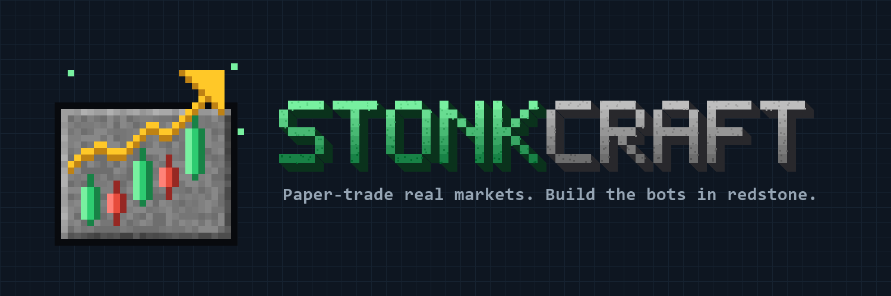
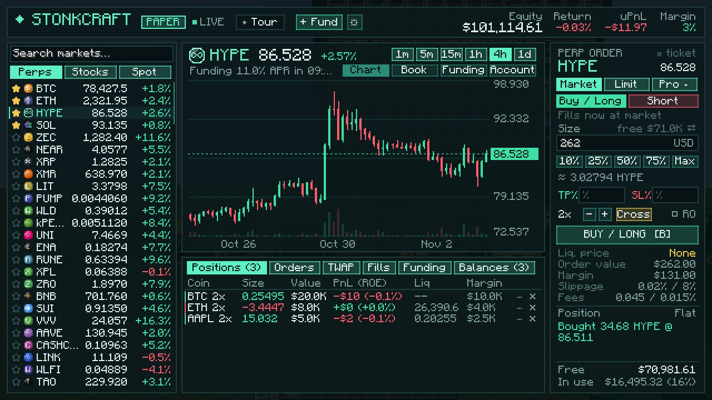
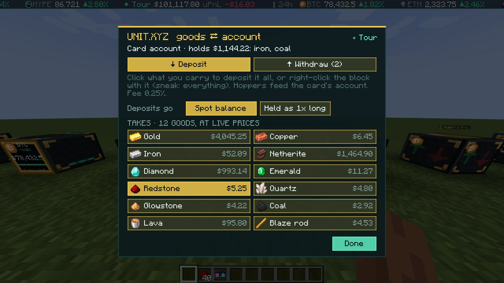
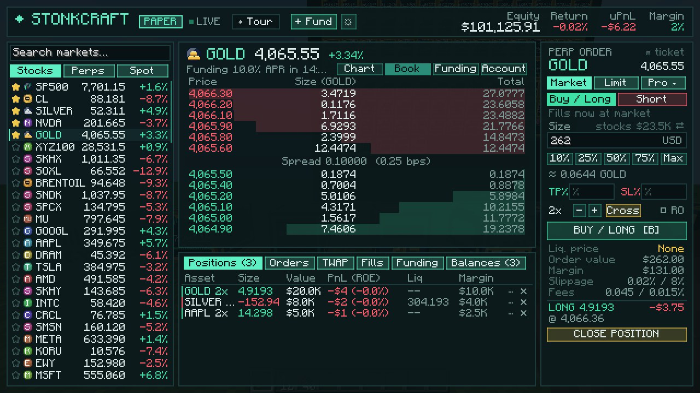
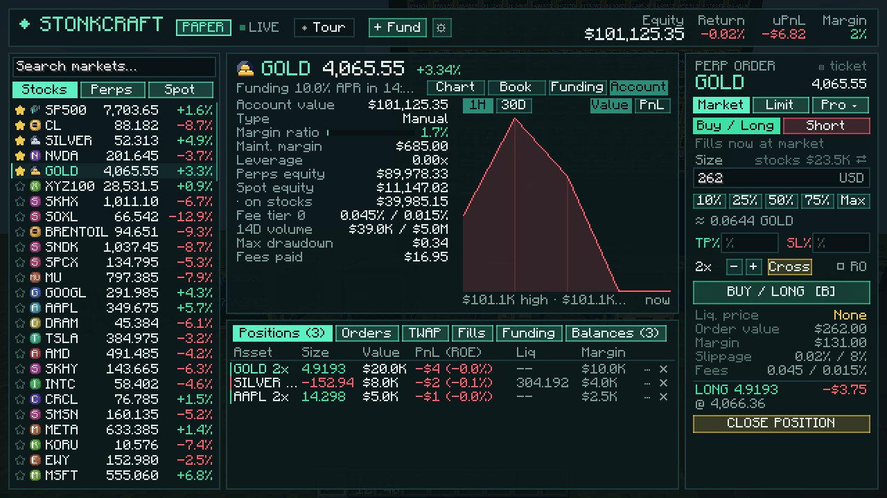
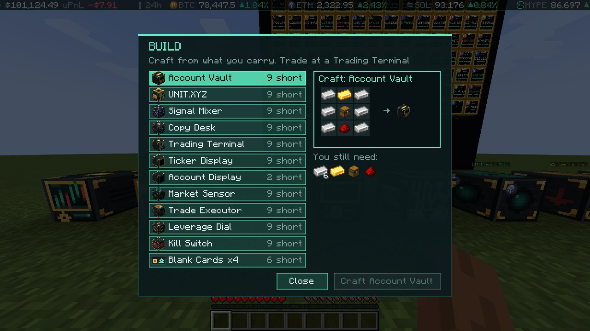
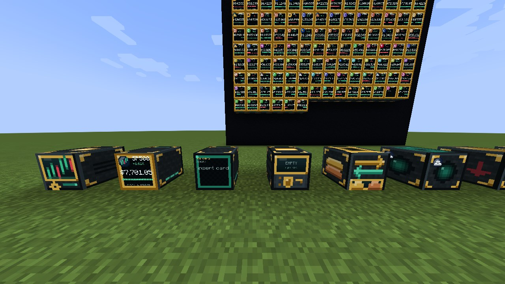
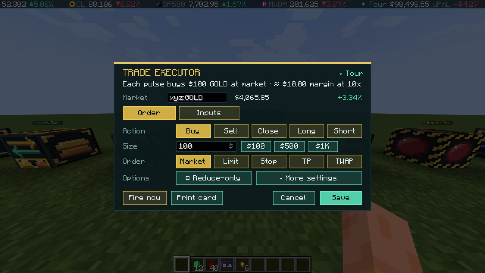
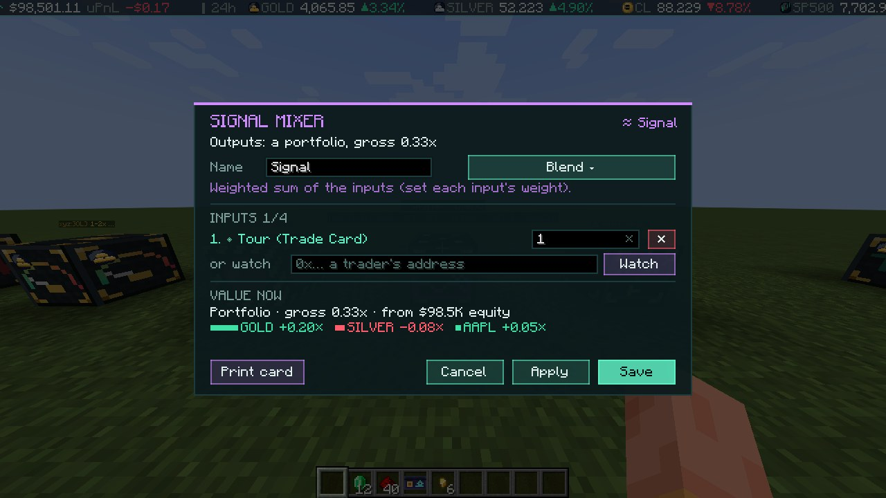
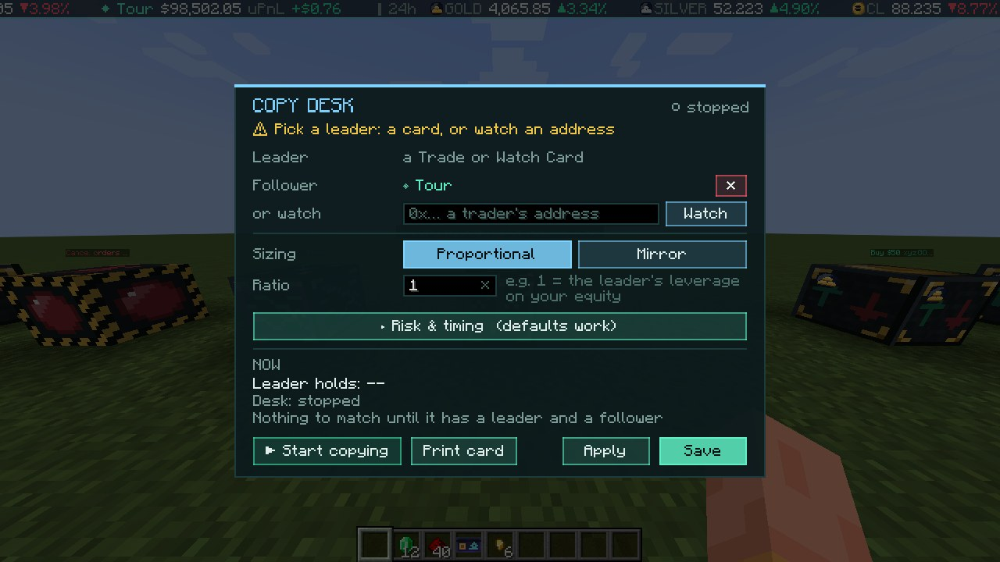

**Paper-trade stocks and commodities at live prices, inside Minecraft.**
Mine your stake, build a trading floor, and automate it with redstone.

[Download](https://modrinth.com/mod/stonkcraft) · [Guide](docs/GUIDE.md) · [Changelog](CHANGELOG.md) · [Report a bug](https://github.com/0xSemicolon/stonkcraft/issues)

Stonkcraft turns Minecraft into a trading floor. Apple, Nvidia, the S&P 500, gold, silver, oil, natural gas and the
euro stream into your world at **live market prices**, and you trade them with money you **earn by mining**. It's a
real trading simulator wrapped in a survival game: real order types, real margin rules, real liquidations, and not a
single real dollar at stake.

## Why Stonkcraft

- **Learn markets by playing them.** Limit orders, stop-losses, leverage, margin and liquidation all behave the way
  they do on a real exchange. The only thing that's fake is the money.
- **Money is earned, not handed out.** There's no starter cash. Mine gold, iron, diamonds and coal, sell them at
  live commodity prices, and grow that stake by trading. Your gold farm is now your trading desk's funding.
- **Redstone meets algorithmic trading.** Sensors read prices and PnL, executors place orders on a pulse, and kill
  switches flatten everything. If you can build a redstone clock, you can build a trading bot.
- **Built for servers.** Shared accounts with per-player permissions, scoped access cards, copy trading, leaderboards
  and a Wall Street speedrun.
- **Safe by design.** Paper trading only: no wallet, no keys, nothing to buy, and no order ever leaves the game.

## Mine your stake

Craft a **Commodity Exchange** and sell what you dig up at live prices: gold as gold, iron as silver, diamonds as
palladium, coal as natural gas, a lava bucket as a barrel of crude. Twelve goods in all, and other mods' metals count
too. Buy them back out as items whenever you like, and the gold you withdraw is real Minecraft gold.

## Trade like a professional

The **Trading Terminal** is a full brokerage screen: candlestick charts from 1 minute to 1 day, a live order book,
market, limit, stop, take-profit, scale, trailing-stop and TWAP orders, TP/SL brackets, leverage, cross or isolated
margin, and an account view with your PnL curve and fee tier. Paper accounts follow real exchange rules down to
maintenance margin and staged liquidation, so getting margin-called is very educational.

| Order book and depth | Account and PnL |
|---|---|
|  |  |

## Build your trading floor

Press **H** for the build menu: every block's recipe, what you're still missing, and one-click crafting from what you
carry. Recipes unlock as you find copper, iron and gold, and none of the first ones need the Nether. Blocks that touch
an Account Vault share its account, so `[vault] [exchange] [terminal]` in a row just works.

| Build menu | The blocks |
|---|---|
|  |  |

## Automate it with redstone

- **Market Sensor**: redstone when a price moves, an order fills, your PnL crosses a line or the NYSE bell rings.
- **Trade Executor**: places a market, limit, stop or TWAP order on every pulse, sized from a fixed amount or a signal.
- **Leverage Dial** and **Kill Switch**: dial leverage with signal strength; cancel and flatten on a pulse.
- **Order Tickets**: write an order on paper, and an executor works through a chest of them.

| Trade Executor | Signal Mixer |
|---|---|
|  |  |

## Copy trades and compose strategies

A **Copy Desk** follows any public trader's account, live, on your paper account. **Signal Mixers** blend, fade,
filter, gate and delay portfolios, so strategies like *copy these three traders, but only their stock trades, and
only while the NYSE is open* are a handful of blocks. Every reading can be printed as a **Signal Card** and fed into
any other block.

## Quick start

1. Install [Fabric Loader](https://fabricmc.net/use/) for Minecraft **1.21.1**, and put
   [Fabric API](https://modrinth.com/mod/fabric-api) and Stonkcraft
   ([Modrinth](https://modrinth.com/mod/stonkcraft) or [GitHub Releases](https://github.com/0xSemicolon/stonkcraft/releases))
   in your `mods` folder. On a server, install it on the server and every client.
2. Join a world. A welcome screen walks you through the first steps.
3. Craft an **Account Vault**, a **Commodity Exchange** and a **Trading Terminal** (press **H**), sell some ore, and
   place your first trade.

The [guide](docs/GUIDE.md) covers every block, command and setting.

## For server owners

- `config/stonkcraft.json` sets starter grants, the paper mint, leverage limits and fees. By default there's no free
  money: everything is mined.
- `config/stonkcraft-exchange.json` sets what the Commodity Exchange takes and how each good is priced, by item or tag.
- Vault owners grant view or trade access per player, with limits on order size, leverage, markets and expiry; every
  action is in the account's activity log.
- `/stonk signal score` puts any signal on a scoreboard for command blocks and datapacks.

## Paper trading, network use and privacy

Everything in Stonkcraft is paper money. Nothing in the game is worth real money, there's nothing to buy, the mod holds
no keys and never sends an order to an exchange, and nothing here is financial advice.

The game needs internet access for prices. The server reads public market data (prices, order books, funding, and any
public accounts you choose to watch or copy) from Hyperliquid's public API over HTTPS and WebSocket. It sends no
player data, has no telemetry, and makes no other connections. Markets are shown with generic pictures or
lettered badges, never other companies' logos.

Stonkcraft is a fan-made mod and isn't affiliated with or endorsed by any exchange or data provider, the New York Stock
Exchange or Mojang.

## Contributing

Bug reports and ideas are welcome in [issues](https://github.com/0xSemicolon/stonkcraft/issues). To build from source,
see [docs/DEVELOPING.md](docs/DEVELOPING.md). Stonkcraft is [MIT licensed](LICENSE).

Stonkcraft was built with an AI coding assistant (Claude), which wrote most of the code, the scripts that draw the
textures, and much of the documentation, under the author's direction, design and testing.
