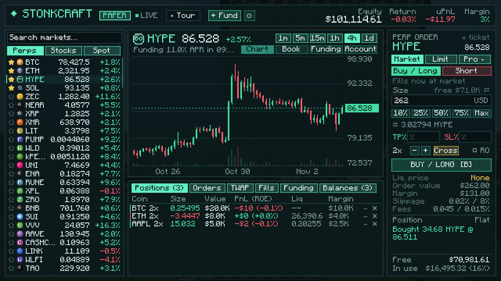
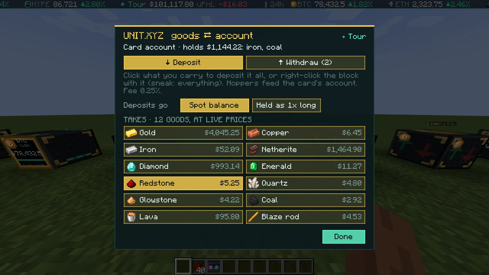

<!--
Modrinth project settings (project YBz078rg, slug stonkcraft)
  Title:       Stonkcraft
  Summary:     Paper-trade stocks and commodities at live prices, fund it by mining, and build trading bots from redstone.
  Categories:  Economy, Technology, Game Mechanics
  Environment: client required, server required
  Disclosures: Contains AI-generated content (rules §6.1: the code, art scripts and copy were written with Claude)
  License:     MIT    Source: https://github.com/0xSemicolon/stonkcraft    Issues: .../issues
  Icon:        replace with an owner-made icon (the current one is AI-derived; see rules §6.2)
  Gallery:     terminal, unit_bridge, build_menu, trade_executor,
               copy_desk, blocks (.jpg)
  Versions:    pushing a v* tag publishes one (.github/workflows/build.yml)
The body below goes in the Description field.
-->

**Stonkcraft is a paper-trading mod.** It brings live prices for stocks, indices and commodities (Apple, Nvidia, the
S&P 500, gold, silver, oil, natural gas, the euro and more) into your world, and lets you trade them with in-game money
you earn by mining. No real money is involved at any point: there's nothing to buy, no wallet, no keys, and no order
ever leaves the game.

### How it plays

- **Mine for your stake.** Money is earned, not handed out. Sell ores, gems, redstone and fuel at a **Commodity Exchange**
  block and they're credited at a live commodity price: gold as gold, iron as silver, diamonds as palladium, redstone
  as chip stocks, coal as natural gas, a lava bucket as a barrel of crude. Withdraw profits back out as ingots.
- **Craft your trading floor.** Press **H** for the build menu. It shows every block's recipe and what you're
  still missing, and crafts it from your inventory. Recipes unlock as you pick up copper, iron, gold, paper or
  redstone, and none of the first ones need the Nether.
- **Trade at a Trading Terminal.** It works like a real brokerage screen: market, limit, stop, take-profit, scale,
  trailing-stop and TWAP orders, TP/SL brackets, leverage, live candles and an order book.
- **Real margin rules, fake money.** Paper accounts follow real exchange rules: maintenance margin, staged
  liquidation, funding, fee tiers by volume, and separate balances. Getting margin-called in Minecraft is very
  educational.
- **Build bots out of redstone.** A **Market Sensor** emits redstone on a price move, a fill, your PnL or the NYSE's
  opening bell. A **Trade Executor** places an order on a pulse. Add a **Kill Switch**, a **Leverage Dial** and
  **Order Tickets**.
- **Compose signals and copy-trade.** **Signal Mixers** blend, fade, filter, gate and delay portfolios. A **Copy
  Desk** follows any public trading account, live, on your paper account.
- **Wall Street speedrun**: mine, trade, withdraw, kill the dragon. `/stonk speedrun start`.

### Install

Fabric Loader and [Fabric API](https://modrinth.com/mod/fabric-api) on Minecraft **1.21.1**. Install it on the server
and on every client. Commands are under `/stonk`; settings live in `config/stonkcraft*.json`.

### Network use

Stonkcraft needs internet access. The server reads public market data (prices, order books, funding, and any public
accounts you choose to watch or copy) from Hyperliquid's public API over HTTPS and WebSocket. It sends no player
data, has no telemetry, and makes no other connections.

### Good to know

- Everything is paper trading. Nothing in the game is worth real money, and nothing here is financial advice.
- The terminal also lists the data feed's other futures and spot markets alongside stocks and commodities.
- It's a fan project, not affiliated with or endorsed by any exchange or data provider, the NYSE or Mojang.
- Markets are shown with generic pictures or lettered badges, never other companies' logos.
- Server owners: `config/stonkcraft.json` controls starter grants, the paper mint, leverage and fees.
- How it's made: Stonkcraft was built with an AI coding assistant (Claude), which wrote most of the code, the scripts
  that draw the textures, and much of this page, under the author's direction, design and testing.

Source, full docs and issues: [GitHub](https://github.com/0xSemicolon/stonkcraft)